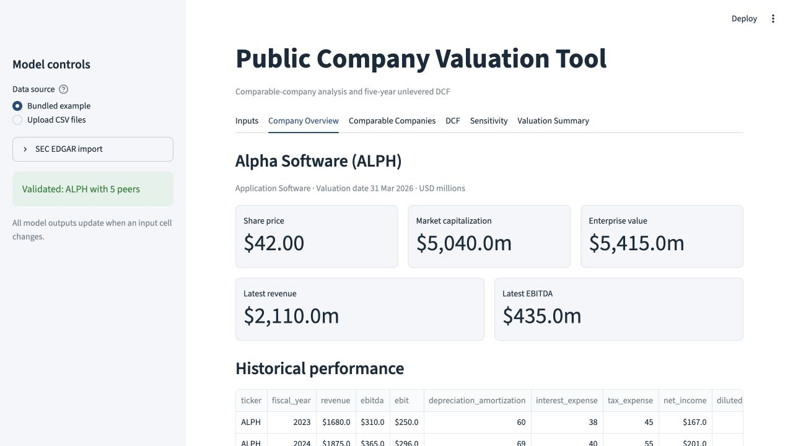
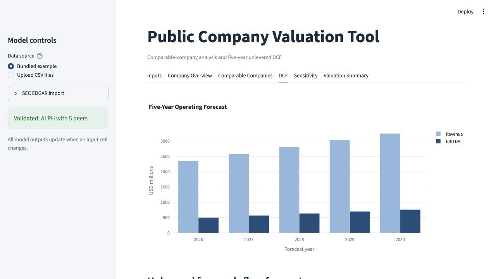
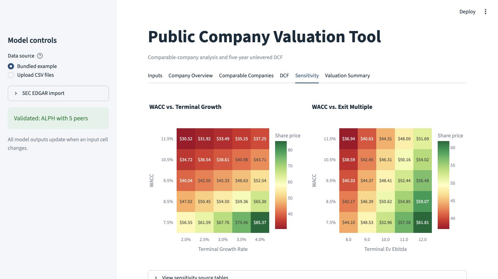
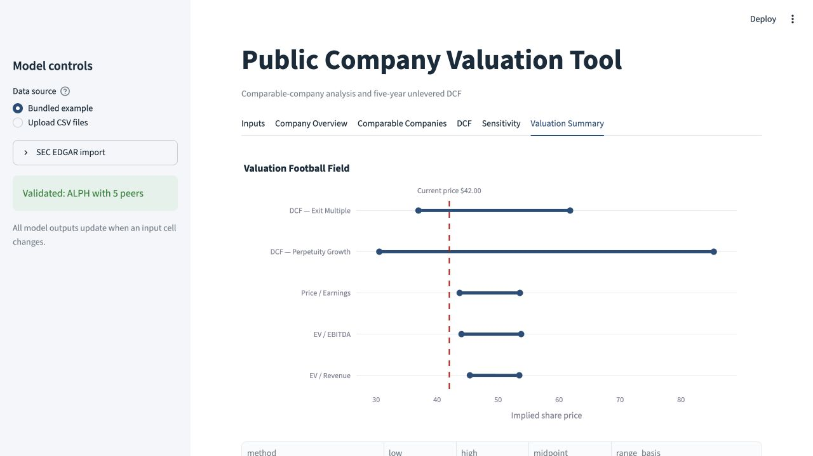

# Public Company Valuation & Comparable Companies Tool

A Python valuation application that combines comparable-company analysis and a
five-year unlevered DCF to estimate an implied equity value and share-price
range for a US-listed public company.



## Valuation visuals

| DCF forecast | Sensitivity analysis |
|---|---|
|  |  |



The portfolio release is complete: validated inputs, comparable-company and DCF
engines, sensitivities, visualizations, Streamlit workflow, Excel reporting,
optional SEC EDGAR integration, automated tests, and CI are operational.
The complete scope, assumptions, exclusions, and acceptance criteria are in
[`docs/mvp_scope.md`](docs/mvp_scope.md).

## MVP at a glance

- US-listed, non-financial target companies
- Three fiscal years of historical financial data
- Five explicit forecast years
- Five to ten manually selected public-company peers
- EV/Revenue, EV/EBITDA, and P/E trading multiples
- DCF using perpetuity-growth and exit-multiple terminal values
- WACC/terminal-growth and WACC/exit-multiple sensitivity tables
- Valuation football field and downloadable results
- CSV/manual inputs in the first working version

## Delivery sequence

1. Define MVP scope — complete
2. Set up the Python project and application structure — complete
3. Define and validate the financial-data schema — complete
4. Build the manual-input prototype — complete
5. Build the comparable-company valuation engine — complete
6. Build the DCF engine — complete
7. Add editable forecast assumptions — complete
8. Build sensitivity analysis — complete
9. Create the valuation football field — complete
10. Add the Streamlit interface — complete
11. Connect external data — complete
12. Add testing and reconciliation — complete
13. Add report export — complete
14. Prepare the portfolio presentation — complete

## Local setup

```bash
python3 -m venv .venv
source .venv/bin/activate
python -m pip install -e ".[dev]"
pytest
streamlit run app.py
```

Validate the included fictional example dataset with:

```bash
valuation-validate data/raw/example
```

See [`docs/input_data.md`](docs/input_data.md) for the full data dictionary,
units, signs, and validation rules.

Run the comparable-company analysis with:

```bash
valuation-comps data/raw/example
```

See [`docs/comparable_companies.md`](docs/comparable_companies.md) for formulas,
invalid-multiple treatment, and output definitions.

Run the five-year DCF with:

```bash
valuation-dcf data/raw/example
```

See [`docs/dcf.md`](docs/dcf.md) for the forecast, FCFF, discounting, terminal
value, and equity-bridge methodology.

Generate sensitivity tables and interactive charts with:

```bash
valuation-analytics data/raw/example
```

See [`docs/sensitivity_and_charts.md`](docs/sensitivity_and_charts.md) for grid
definitions and football-field range conventions.

Launch the full dashboard with:

```bash
streamlit run app.py
```

See [`docs/streamlit_app.md`](docs/streamlit_app.md) for the six-tab workflow,
custom-upload instructions, and Excel export details.

Import reviewed annual US-GAAP facts from SEC EDGAR with:

```bash
export SEC_USER_AGENT="Your Name your.email@example.com"
export ALPHA_VANTAGE_API_KEY="your-key"  # optional end-of-day prices
valuation-sec AAPL MSFT GOOGL ORCL CRM ADBE
```

See [`docs/sec_edgar_integration.md`](docs/sec_edgar_integration.md) for SEC
access requirements, XBRL mappings, provenance, and review limitations.

## Release checks

```bash
make lint
make coverage
make validate
make release
```

The release builder writes a complete fictional demonstration package to
`outputs/release/`, including a 12-sheet Excel workbook, source CSVs, and
interactive charts.

## Example workflow

1. Launch the dashboard and review the bundled example.
2. Inspect or edit company, historical, forecast, and terminal inputs.
3. Review peer multiples and invalid-observation warnings.
4. Compare the two DCF terminal-value methods.
5. Stress WACC, terminal growth, and exit multiple.
6. Review the football field and download the Excel report.
7. For external data, import a dated provider snapshot, reconcile it to source
   filings, complete the review fields, and upload the reviewed CSVs.

## Methodology and assumptions

- Comparable-company valuation uses EV/Revenue, EV/EBITDA, and P/E.
- Peer ranges use minimum, 25th percentile, median, 75th percentile, and maximum.
- The DCF forecasts five years of unlevered FCFF using end-of-year discounting.
- Terminal value uses both perpetuity growth and terminal EV/EBITDA.
- The example assumes USD reporting and manually approved peers.
- Positive change in working capital is treated as a cash outflow.

Detailed formulas are documented in
[`docs/comparable_companies.md`](docs/comparable_companies.md) and
[`docs/dcf.md`](docs/dcf.md).

## Data sources

- Fictional bundled data for reproducible testing and demonstrations
- SEC EDGAR Company Facts for optional filed US-GAAP financials
- Alpha Vantage `GLOBAL_QUOTE` for optional end-of-day prices
- Manually reviewed CSV inputs and overrides

Every externally imported metric retains provider or XBRL provenance.

## Limitations

- The tool does not automatically approve peers or investment assumptions.
- SEC XBRL mappings must be reconciled to the filed 10-K.
- Free market quotes are end-of-day and can become stale.
- The DCF does not model tax-loss carryforwards or mid-year discounting.
- Banks, insurers, REITs, and other sector-specific models are outside scope.
- The recognizable Apple case study uses a deliberately limited peer snapshot
  and is not a substitute for the complete model.

## Disclaimer

This software and all included analyses are for educational and portfolio
demonstration purposes only. They do not constitute investment advice or a
recommendation to buy, sell, or hold any security.

## Portfolio material

- [`docs/portfolio_case_study.md`](docs/portfolio_case_study.md)
- [`docs/apple_case_study.md`](docs/apple_case_study.md)
- [`docs/model_validation.md`](docs/model_validation.md)
- [`docs/interview_guide.md`](docs/interview_guide.md)
- [`RELEASE_NOTES.md`](RELEASE_NOTES.md)

## Package layout

```text
public-company-valuation-tool/
├── app.py
├── data/
│   ├── processed/
│   └── raw/
├── docs/
├── outputs/
├── src/valuation_tool/
└── tests/
```
