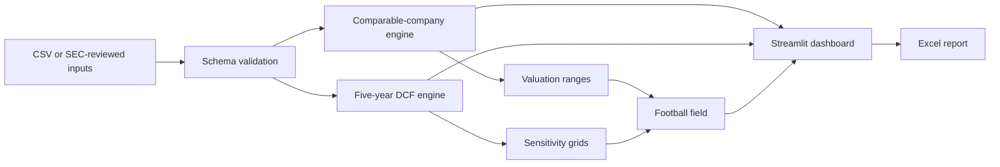

# Portfolio Case Study

## Public Company Valuation and Comparable Companies Tool

### Problem

Public-company valuation is often spread across static spreadsheets, manual
data collection, and charts that are difficult to reproduce. The goal was to
build an auditable Python workflow that preserves standard valuation logic
while making assumptions, validation, sensitivities, and reporting reusable.

### Solution

The application combines:

- validated CSV and editable dashboard inputs;
- comparable-company analysis using EV/Revenue, EV/EBITDA, and P/E;
- a five-year unlevered DCF with two terminal-value methods;
- sensitivity heatmaps and a valuation football field;
- a 12-sheet downloadable Excel valuation workbook; and
- optional SEC EDGAR XBRL ingestion with concept-level provenance.

### Architecture

### Finance decisions

- Enterprise value includes debt, non-controlling interest, and preferred
  stock, less cash and non-operating investments.
- Non-positive valuation denominators are unavailable rather than forced into
  peer statistics.
- The DCF uses unlevered FCFF and end-of-year discounting.
- Terminal value is calculated under both perpetuity-growth and exit-multiple
  methods.
- Comps football-field ranges use peer interquartile values; DCF ranges use
  complete sensitivity grids.

### Engineering decisions

- Calculation engines are independent of Streamlit.
- Input data is normalized into four canonical tables.
- Invalid datasets fail with consolidated, user-readable messages.
- Every SEC-derived metric records its taxonomy, concept, unit, and
  transformation.
- Tests reconcile formulas instead of checking only that code executes.

### Demonstration result

For the fictional Alpha Software case, the five core valuation ranges bracket
the $42.00 reference price. Median comps imply approximately $46–$52 per share;
the base DCF methods imply $45.33 and $48.41. These values demonstrate workflow
behavior, not an investment recommendation.

For a recognizable-company communication example, see the
[Apple case study](apple_case_study.md). It separates reported financial data,
observed market data, mechanical valuation output, and analyst judgment.

### Skills demonstrated

- Corporate finance and valuation
- Financial-statement normalization
- Python package design
- pandas and NumPy
- Interactive Plotly visualization
- Streamlit application development
- Excel report automation
- API integration and XBRL mapping
- Automated testing and continuous integration
